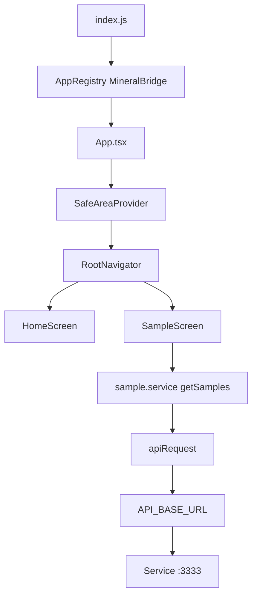

# Mobile App Architecture

Mineral Bridge client for Android and iOS. Version 0.1.0. React Native CLI 0.83.1 and TypeScript, modeled on the Selorg customer app folder layout. It shows a home screen and a sample list loaded from the Mineral Bridge service.

Package name: `mineral-bridge-mobile-app`. Native display name: Mineral Bridge. Registered component name in `app.json`: `MineralBridge`.

Identifiers:

| Platform | ID |
| --- | --- |
| Android `applicationId` and namespace | `com.mineralbridge` |
| iOS `PRODUCT_BUNDLE_IDENTIFIER` | `com.mineralbridge` |
| Android version | versionName 1.0, versionCode 1 |

Requires Node 20 or newer. Android needs the Android SDK and JDK. iOS needs Xcode and CocoaPods (`bundle install`, then `bundle exec pod install` inside `ios/`).

## Stack

| Concern | Choice |
| --- | --- |
| Runtime | React Native 0.83.1, React 19.2 |
| Language | TypeScript 5.8, extending `@react-native/typescript-config` |
| Navigation | Local `useState` in `RootNavigator`. React Navigation is not installed |
| Safe area | `react-native-safe-area-context` 5 |
| Networking | Global `fetch` |
| Styling | `StyleSheet` plus `src/theme` |
| Tests | Jest 29 with the `react-native` preset. No test files are in the tree |
| Lint | `@react-native/eslint-config` |
| Bundler | Metro via `@react-native/metro-config` |

There is no environment loader. API hosts are constants in `src/api/config.ts`.

## Runtime



`index.js` registers `App` under the name from `app.json`. `App.tsx` wraps `RootNavigator` in `SafeAreaProvider`.

`RootNavigator` holds `ScreenName`: `'home' | 'samples'`. Home calls `onSamples` to switch to samples. Samples calls `onBack` to return home. There is no URL, deep link, or back-stack.

## Screens

| Screen | File | Behavior |
| --- | --- | --- |
| Home | `src/screens/home/HomeScreen.tsx` | Title "Mineral Bridge", short description, button "View sample items" |
| Samples | `src/screens/sample/SampleScreen.tsx` | Back button, title, then loading, error, empty list, or `FlatList` |

`SampleScreen` owns its data. On mount it creates an `AbortController`, calls `getSamples`, and stores items. Failures go through `errorMessage` and render an alert plus the hint "Start the service and check src/api/config.ts." Unmount aborts the request. The list uses `item.id` as the key and `SampleCard` as the row. An empty list shows "No sample items."

## Folder layout

```text
mineral-bridge-mobile-app-main/
  index.js                   # AppRegistry
  App.tsx                    # SafeAreaProvider + navigator
  app.json
  metro.config.js
  jest.config.js
  android/                   # Gradle app com.mineralbridge
  ios/                       # Xcode project MineralBridge
  src/
    navigation/
      RootNavigator.tsx
      types.ts               # ScreenName
    screens/<feature>/       # one folder per screen group
    components/SampleCard.tsx
    services/sample.service.ts
    api/
      config.ts              # API_BASE_URL
      index.ts               # apiRequest
    types/sample.ts
    theme/
      colors.ts
      spacing.ts
      index.ts
    utils/errorMessage.ts
```

Convention from the project README:

- Screens go in `src/screens/<feature>/`.
- Navigation, components, theme, API, services, types, and utils follow that split.
- Components are `.tsx`. Helpers are `.ts`.
- Native projects stay in `android/` and `ios/`.
- Context is part of the reference layout and has no folder yet.

## HTTP client

`src/api/config.ts`:

| Platform | Base URL |
| --- | --- |
| Android | `http://10.0.2.2:3333/api` (emulator loopback to the host) |
| iOS | `http://localhost:3333/api` |

A physical device cannot use those hosts. Replace them with the computer's LAN IP before testing on hardware.

`src/api/index.ts` joins `API_BASE_URL` and the path. `getSamples` requests `/samples`, which becomes `{API_BASE_URL}/samples`.

Non-OK responses throw `Error` with the status code. `errorMessage` returns `error.message` when the value is an `Error`, otherwise "Something went wrong".

Android cleartext HTTP is allowed through the manifest placeholder `usesCleartextTraffic`. iOS `Info.plist` keeps `NSAllowsArbitraryLoads` false and sets `NSAllowsLocalNetworking` true, so localhost and LAN HTTP can work while arbitrary public HTTP stays blocked.

Native `fetch` does not use browser CORS. The service still has to be reachable on the host and port above.

## Theme

`src/theme/colors.ts`

| Token | Value |
| --- | --- |
| background | `#f5f7fa` |
| text | `#172033` |
| surface | `#ffffff` |
| border | `#dfe4eb` |

`src/theme/spacing.ts`: small 8, medium 16, large 24.

Screens and `SampleCard` import `colors` and `spacing` from `src/theme`. Cards use surface background, border color, 12px radius, and medium padding.

## Native shells

Android (`android/app`):

- `MainActivity` is the launcher, `singleTask`, `exported`.
- `INTERNET` permission is declared.
- Backup is disabled.
- Debug signing uses the debug keystore. Release still points at the debug signing config and Proguard is off (`enableProguardInReleaseBuilds = false`). Release builds need a real keystore before store deployment.
- Hermes or JSC follows the React Native Gradle flag `hermesEnabled`.

iOS (`ios/MineralBridge`):

- Display name Mineral Bridge.
- Launch storyboard `LaunchScreen`.
- Portrait and both landscapes are allowed.
- `NSLocationWhenInUseUsageDescription` is an empty string. Do not ship location use with that value.
- Signing must be configured in Xcode before a device install.

## Scripts

| Script | Command |
| --- | --- |
| `npm start` | Metro |
| `npm run android` | `react-native run-android` |
| `npm run ios` | `react-native run-ios` |
| `npm run typecheck` | `tsc --noEmit` |
| `npm run lint` | `eslint .` |

## How to add a feature

1. Add a screen name to `ScreenName` in `src/navigation/types.ts` and a branch in `RootNavigator`. For a real navigation stack, introduce React Navigation and keep screens in `src/screens/<feature>/`.
2. Add the response type in `src/types`.
3. Add `src/services/<feature>.service.ts` calling `apiRequest`.
4. Put shared rows in `src/components`.
5. Use `errorMessage` for caught failures and `colors` / `spacing` for layout.

## Boundaries

- Two screens only. No tabs, auth flow, or persistence.
- API host is compiled into source. Changing environments means editing `src/api/config.ts`.
- Sample loading is local component state, not a shared cache.
