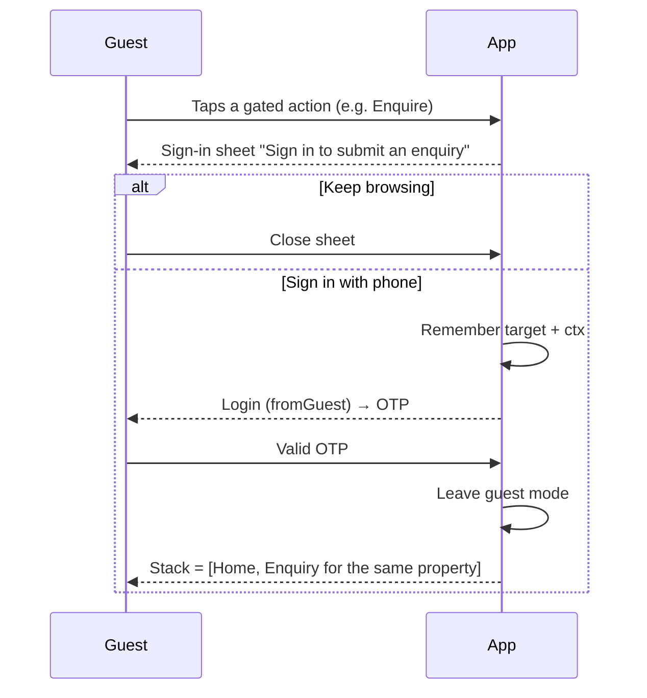
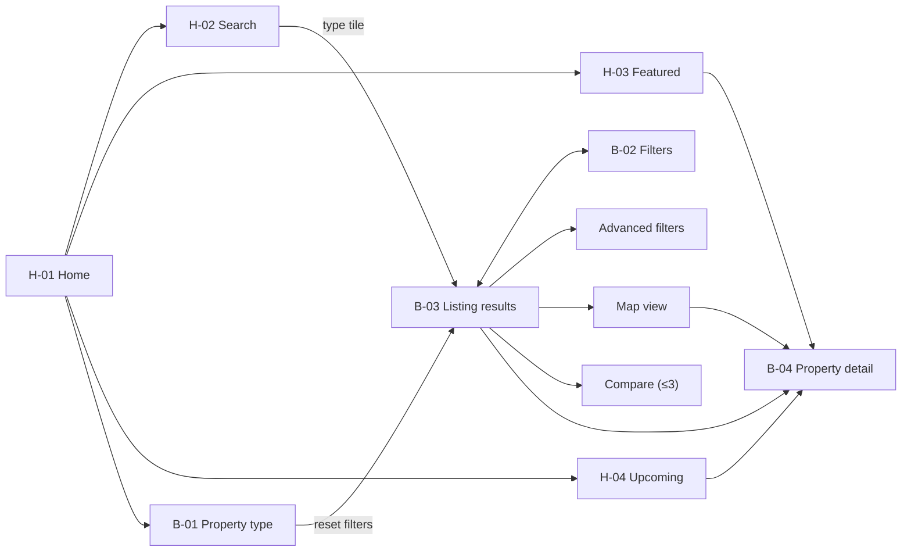
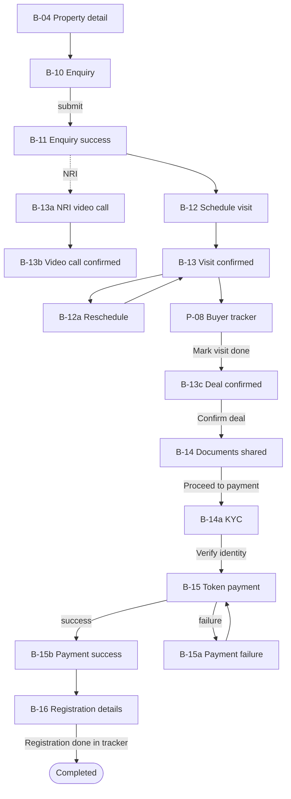
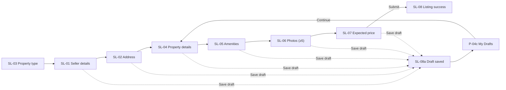
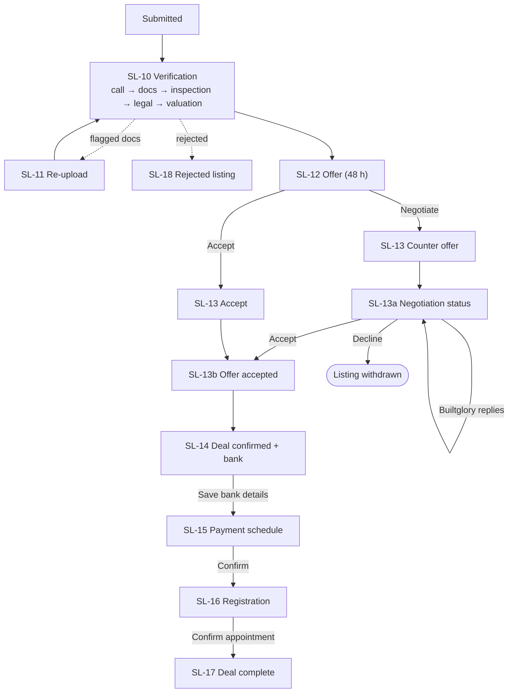
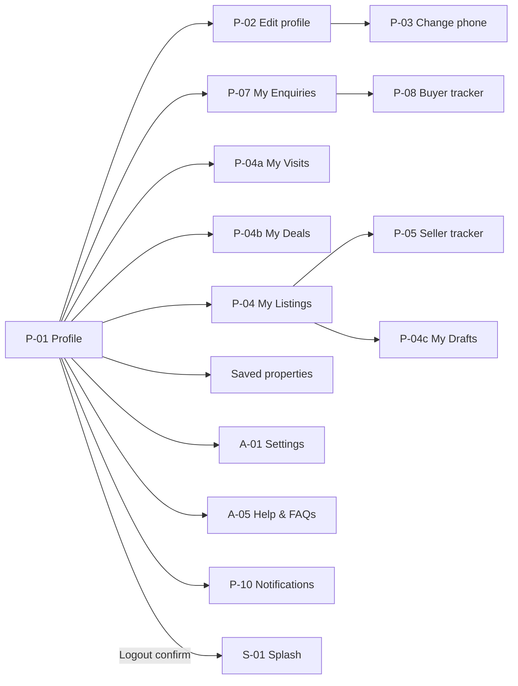

# Builtglory Customer App — Workflows

End-to-end user journeys through the app, with the screen IDs used in [navigation/screens.ts](../src/navigation/screens.ts). Rules and thresholds referenced here are detailed in [BUSINESS_LOGIC.md](BUSINESS_LOGIC.md).

---

## 1. Navigation model

Source: [RootNavigator.tsx](../src/navigation/RootNavigator.tsx).

- A local stack of `{ screen, ctx }` entries. React Navigation is not used.
- `go(screen, ctx)` pushes. `back()` pops; at the root it returns to Home. `jump(screen)` resets the stack to `[home]` or `[home, screen]`.
- `ctx` carries the selected property (`p`), listing id (`lid`), form values and origin flags between screens.
- Android hardware back closes, in order: the guest gate, coach marks, then the top screen. From the root of Home or Splash it exits.
- An edge swipe from the left (beyond 30% of the width) goes back.
- Bottom tabs:

| Tab | Signed in | Guest |
| --- | --- | --- |
| Home | Home (H-01) | Home |
| Buy | Property Type (B-01) | Property Type |
| Sell | Property Type (SL-03) | Sign-in gate |
| Profile | Profile (P-01) | Guest Profile (P-00) |

- Any `go('propertyDetail')` on a sold-out property opens Sold Out (B-19) instead.
- A route with no screen opens a fallback that links Home.

---

## 2. First launch and sign-up

```mermaid
flowchart TD
  S01["S-01 Splash<br/>auto 2.6 s"] --> S02["S-02 Onboarding<br/>3 slides"]
  S02 -->|Get Started| S03["S-03 Login / Sign up"]
  S03 -->|Continue as guest| H01G["H-01 Home (guest)"]
  S03 -->|Send OTP| S04["S-04 OTP"]
  S04 -->|sign in| H01["H-01 Home"]
  S04 -->|sign up| S05["S-05 Create Profile"]
  S05 --> S06["S-06 Location + User type"]
  S06 --> S07["S-07 Terms & Privacy"]
  S07 --> S08["S-08 Permissions"]
  S08 --> H01
  H01 -.first visit, 0.8 s.-> H06["H-06 Coach marks<br/>4 steps"]
```

Steps:

1. **Splash** advances after 2.6 s. After 5 s with no progress it shows Retry. If a token exists, tapping skips to Home.
2. **Onboarding** has 3 slides that auto-advance, swipe, or step with Next. The last slide's button is Get Started.
3. **Login**: choose Sign in or Sign up. Enter a 10-digit phone (and a name for sign-up). Social buttons continue the same way in the prototype.
4. **OTP**: 6 boxes, auto-advance focus, backspace moves back. 60 s resend timer.
5. **Sign-up only**: Create Profile → Location + User type (Resident / NRI / PIO) → Terms → Permissions.
6. **Home** shows coach marks once per session: Search, Buy, Sell, then a final step.

---

## 3. Guest browsing and resume



Guest Profile (P-00) groups features under "Needs an account" (locked) and "Open to everyone" (App Settings, Help & FAQs, About Us, Terms).

---

## 4. Discover properties



- **Home**: search bar, Buy and Sell tiles, Featured (For Sale) and Upcoming carousels, notification bell with unread count, help link.
- **Search**: live results on title + location, recent searches, trending areas, property type tiles, filter shortcut.
- **Featured list**: list or grid view, sort Newest / Price low–high / Price high–low.
- **Upcoming list**: launch countdown and a "notify me" toggle per property.
- **Listing results**: loading skeleton (0.6 s), quick chips, filter count with Clear, map, compare and filter dock buttons. Empty state offers "Change filters".
- **Filters**: type, budget, area, BHK, sort; live result count; Reset. Opened from results, it applies and goes back; otherwise it opens results.

---

## 5. Property detail

From B-04 the buyer can:

| Action | Opens |
| --- | --- |
| Swipe gallery, tap for fullscreen | In-screen viewer with download |
| Heart | Toggle favourite (gated for guests) |
| Share | B-09 Share (WhatsApp, other channels, copy link) |
| Location row | Map view |
| Floor plan thumbnail | B-04a Floor plan (plans, zoom, download) |
| Explore: VR Tour, Aerial, Specs, Location, Advantages, Compare | B-07, B-08, B-05, B-06a, B-06, Compare |
| Schedule Visit | B-12 (needs an enquiry first) |
| Enquire | B-10 |

---

## 6. Buyer journey: enquiry to registration



| Step | Buyer does | Stage after |
| --- | --- | --- |
| 1 | Submits enquiry (interests, contact preference, consent) | 1 Advisor call |
| 2 | Waits for the advisor call (simulated 6 s) | 2 Site visit |
| 3 | Books a visit date and slot; can reschedule | 2 |
| 4 | Marks the visit done (tracker, My Visits or enquiry card) | 3 Deal confirmed |
| 5 | Reviews the term sheet and taps Confirm deal | 4 Documents shared |
| 6 | Views or downloads documents, then Proceed to Token Payment | 5 KYC |
| 7 | Enters PAN, Aadhaar, uploads ID, consents | 6 Token payment |
| 8 | Pays ₹2,50,000 by bank transfer, UPI or cheque | 8 Registration |
| 9 | Reviews the Sub-Registrar appointment and documents to carry | 8 |
| 10 | Marks registration done | 9 Completed |

Where the next action lives:

- **Buyer Tracker (P-08)**: a timeline of all 10 stages with a pager. Each stage shows a detail line and the actions valid for it. Cancel enquiry is here.
- **My Enquiries (P-07)**: one card per record with stage-specific primary and secondary actions (`enquiryActions`). Tabs: All, Active, Done, Cancelled.
- **My Visits (P-04a)**: Upcoming, Completed, Cancelled. Upcoming visits offer Reschedule and Mark visited; completed ones offer Continue to deal.

Exits:

- **Cancel** from the tracker with a reason. The record moves to the Cancelled tab with "Enquire again".
- **Property withdrawn (B-18)** offers Browse similar.
- **Sold out (B-19)** offers View similar properties.

---

## 7. Seller journey: listing to sale

### 7.1 Create a listing



1. **Property type**: pick one of 13 types. A "sold recently" strip and a call-support card are shown.
2. **Seller details**: name, email, confirmation.
3. **Address**: door, street, area, city, state, pincode, landmark, map pin.
4. **Property details**: fields depend on the type. Missing required fields are highlighted.
5. **Amenities**: standard list plus extras (Modular Kitchen, Marble flooring, AC, and more).
6. **Photos**: at least 5, with shooting tips.
7. **Expected price**: price and Negotiable toggle. Submit creates the listing.
8. **Success**: next steps (Document review 12–24 h, Site inspection 2–3 days, Legal verification 3–5 days, Offer). Links to Home, My Listings and the tracker.

### 7.2 Verification to sale



| Step | Seller does | Stage after |
| --- | --- | --- |
| 1 | Waits while Builtglory verifies (simulated 6 s per stage) | 1 → 6 |
| 2 | Opens the offer, sees the 48-hour countdown | 6 Offer sent |
| 3a | Accepts | 8 Deal confirmed |
| 3b | Counters (up to 3 times); Builtglory accepts or revises | 7 Negotiation |
| 4 | Accepts the latest Builtglory amount | 8 |
| 5 | Enters and confirms bank details | 10 Payment schedule |
| 6 | Confirms the payout schedule | 11 Registration |
| 7 | Ticks the documents checklist and confirms the appointment | Sold |
| 8 | Downloads the sale deed from Deal Complete | — |

The **Seller Tracker (P-05 / SL-10)** shows all 13 stages with detail text, timestamps and a dock button for the next valid action. Before stage 6 the dock shows "{stage} in progress…".

### 7.3 Seller tools (Extras)

- **Seller enquiries**: buyer messages with status; Schedule and Chat actions.
- **Seller visits**: accept or decline requested visits.
- **Negotiation chat**: message thread with a composer.

---

## 8. Profile and account



- **Change phone**: new number → Send OTP → 6-digit code → Verified → back to Edit Profile.
- **Notifications**: grouped by day; swipe left to dismiss.
- **Document viewer (P-11)**: page through a PDF preview; opened for term sheet, sale deed, receipts and shared documents.

---

## 9. Settings and support

| Path | Purpose |
| --- | --- |
| A-01 → A-02 Notification settings | Choose alert categories |
| A-01 → A-03 App settings | Language, dark mode, location source (GPS default) |
| A-01 → A-04 Account settings | Change password; Delete account → A-04a (type `DELETE`) → Splash |
| A-05 Help & FAQs → A-06 Topic | Search FAQs, 8 topics (Buying, Selling, Legal, Payment, NRI, App Usage, Account, Other) |
| A-07 Customer support | Request a callback with a time slot; Call us |
| A-07a Call us | Phone contact, link to callback |
| A-08 About us | Mission, how it works, legal links, contact support |
| H-05 Help & Support | FAQ accordion, callback form, feedback with confirmation toast |

---

## 10. System states

| Screen | Trigger (intended) | Action |
| --- | --- | --- |
| G-01 No internet | Network lost | Retry (returns Home after 1.4 s today) |
| G-02 Force update | App config says the version is too old | Update |
| G-03 Maintenance | Service in maintenance | Wait |
| G-04 Session expiry | Refresh token rejected | Log in |

These screens exist and are registered. Nothing routes to them automatically yet; wire them to `GET /app/config` and HTTP 401 handling.
