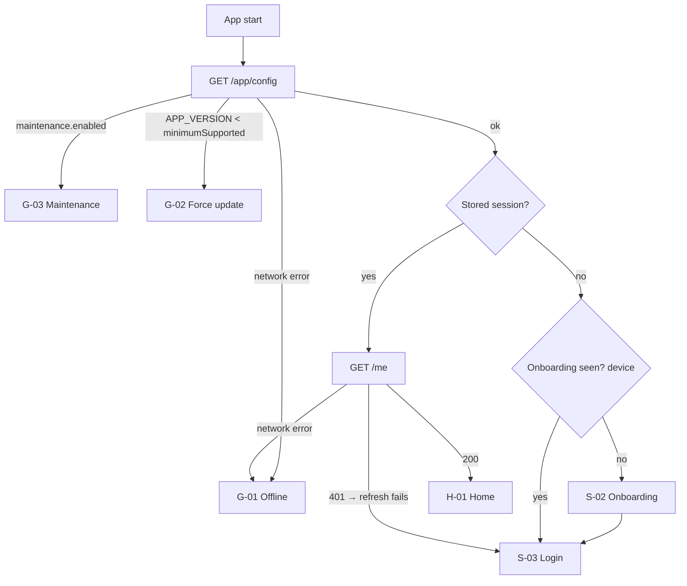
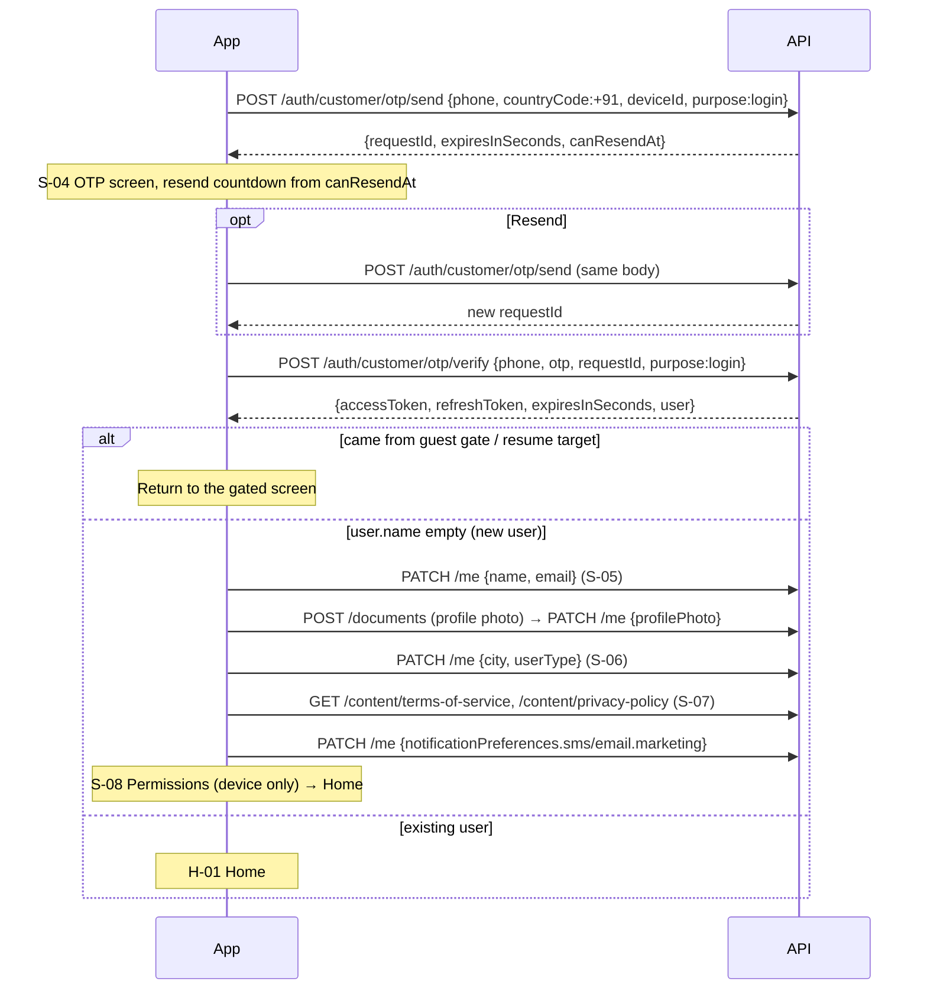
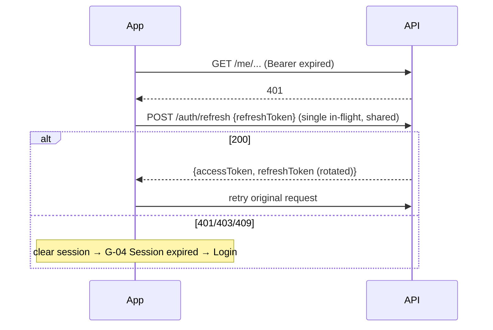
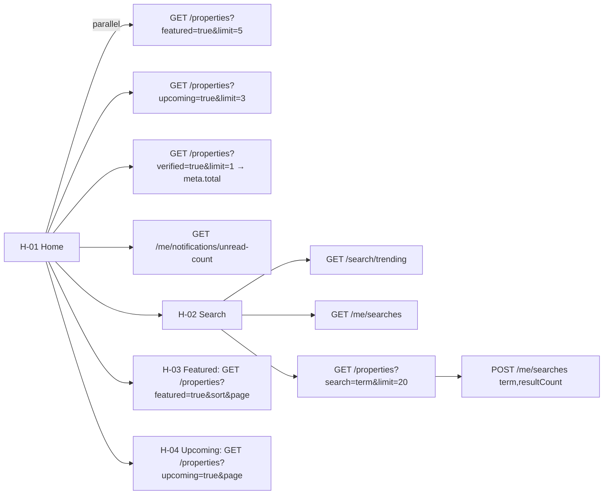
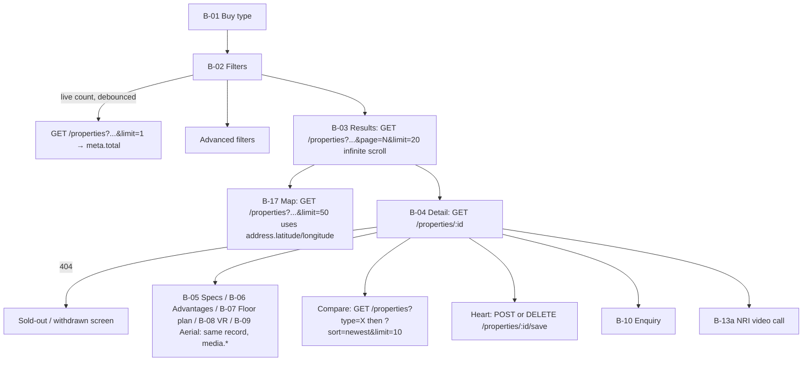
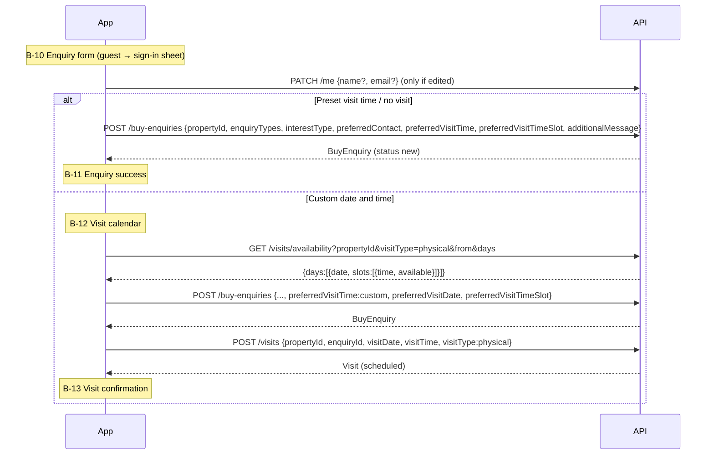
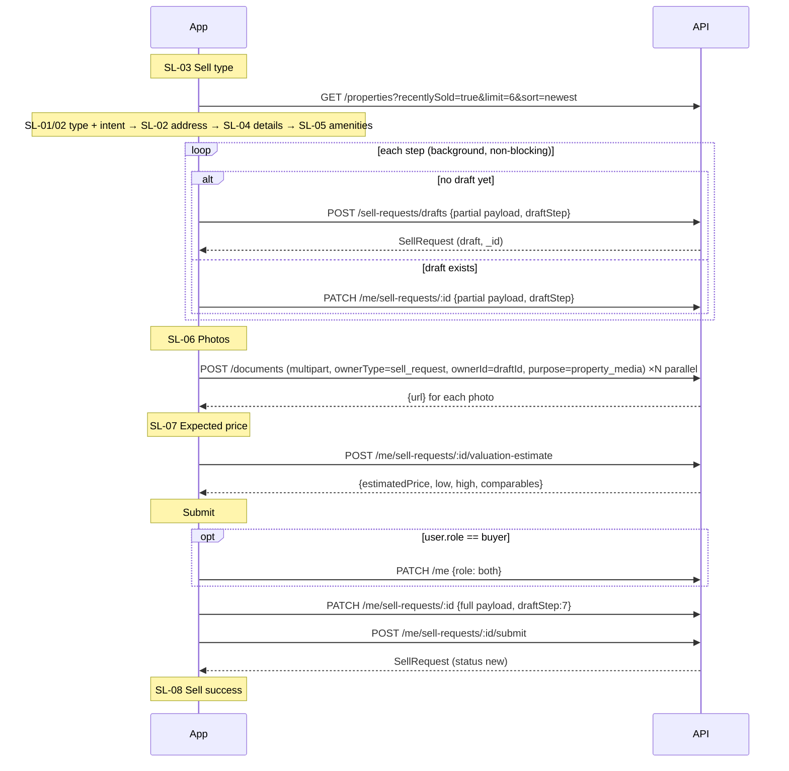
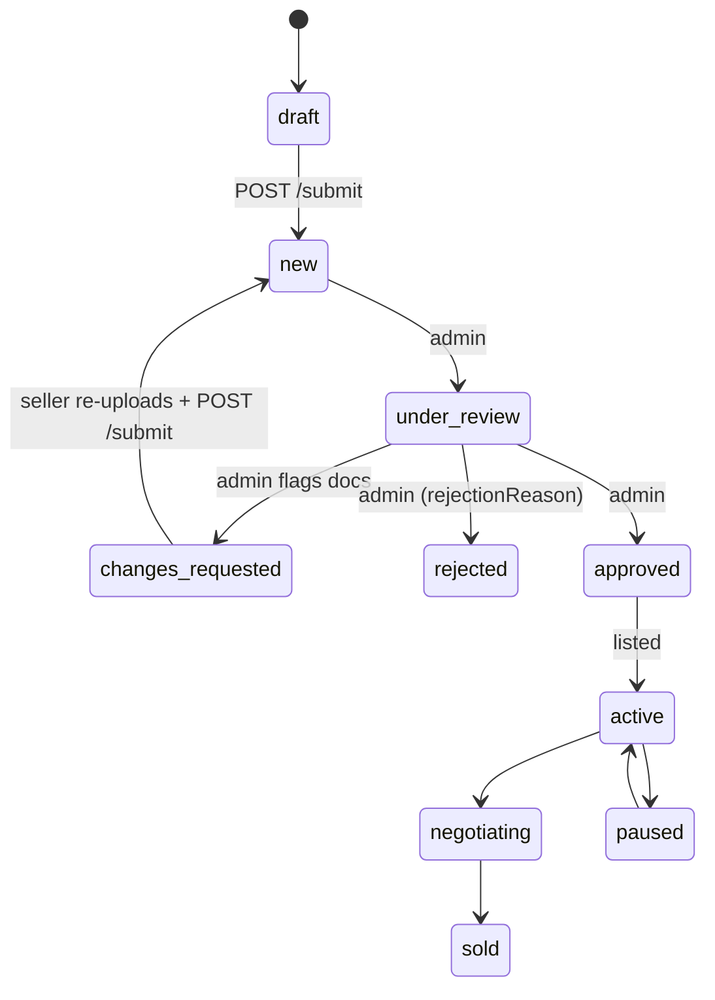

# BuiltGlory Customer App: End-to-End Workflows

These are the user journeys and the exact order of API calls each one makes. The diagrams use Mermaid and render on GitHub and in VS Code with a Mermaid extension. Screen codes (S-, H-, B-, SL-, P-, A-, G-) match the design reference.

---

## 1. App launch / Splash (S-01)



---

## 2. Login / signup with OTP (S-03 → S-08)



**Guest mode:** "Explore as guest" on Login goes to Home without a token. Gated actions open a sign-in sheet, and after login the app returns to the screen the user wanted.

---

## 3. Token refresh (any screen)



---

## 4. Home and discovery (H-01 … H-04)



---

## 5. Buy: browse → filter → detail (B-01 … B-09)



---

## 6. Buy: enquiry and site visit (B-10 → B-13)



**Booking a visit from an existing enquiry** skips the enquiry creation and calls `POST /visits` with the `enquiryId` it already has.

**NRI video call (B-13a):** `GET /visits/availability?visitType=virtual`, then `POST /visits {visitType:'virtual', virtualPlatform}`, then B-13b confirmation.

**Reschedule (B-12a):** `GET /visits/availability`, then `PATCH /visits/:id/reschedule {visitDate, visitTime}`, then the confirmation screen with `rescheduled: true`.

**Cancel (B-17):** `PATCH /visits/:id/cancel {reason}` for a visit, or `PATCH /me/buy-enquiries/:id/cancel` for the whole enquiry.

---

## 7. Buy: deal, token payment, documents and registration (B-14 … B-16)

```mermaid
sequenceDiagram
  participant Admin as Admin dashboard
  participant API
  participant App
  Admin->>API: Create sales deal for enquiry, move stages (site_visits → negotiation → token_payment)
  App->>API: GET /me/buy-enquiries (deal embedded) → My Deals progress
  Note over App: B-15 Payment
  App->>API: GET /me/buy-enquiries/:id
  App->>API: GET /me/payments?dealId&type=token
  App->>API: GET /app/config (tokenAmount, escrow)
  Note over App: User transfers via bank / UPI / cheque outside app
  App->>API: POST /payments/token {dealId, propertyId, amount, method, idempotencyKey}
  API-->>App: Payment (pending)
  alt failed / rejected / cancelled
    Note over App: Payment failure screen (failureReason)
  else pending / paid
    Note over App: B-16 Registration details
  end
  Admin->>API: Verify payment → paid, deal.financials.tokenPaid=true, stage → documentation
  Admin->>API: Attach deal.documentation.documents[].files[], set sentToBuyerAt
  App->>API: GET /me/buy-enquiries/:id → B-14 Documents shared (only sentToBuyerAt)
  App->>API: GET /documents/:id/read-url (private file viewer)
  Admin->>API: Set deal.documentation.registration {registrationDate, office, fees}
  App->>API: GET /me/buy-enquiries/:id → B-16 shows appointment
  Admin->>API: Deal stage → closed; enquiry status → closed
  Note over App: Enquiry shown as Completed
```

---

## 8. Sell: listing wizard (SL-01 → SL-08)



**Save as draft:** the app saves and shows Draft success. The draft can be resumed later from My Listings (`GET /me/sell-requests/:id` loads it back into the form).

---

## 9. Sell: verification → offer → deal → payout → registration (SL-10 … SL-17)



```mermaid
sequenceDiagram
  participant Admin
  participant API
  participant App as Seller app
  App->>API: GET /me/sell-requests/:id/activity  (SL-10 timeline)
  Admin->>API: Create acquisition (pending_review → site_inspection → valuation)
  opt documents flagged
    Admin->>API: documents[i].status=rejected / status=changes_requested
    Note over App: SL-11 Re-upload
    App->>API: POST /documents (purpose=legal, documentType=doc name)
    App->>API: PATCH /me/sell-requests/:id {documents}
    App->>API: POST /me/sell-requests/:id/submit
  end
  Admin->>API: Create offer {amount, expiresAt}
  Note over App: SL-12 Offer
  App->>API: GET /activity + POST /valuation-estimate (area average)
  alt Accept
    App->>API: POST /offer-decision {decision: accepted}
  else Counter
    App->>API: POST /offer-decision {decision: countered, counterAmount, notes}
    Admin->>API: Respond (new offer / accept counter)
  end
  Note over App: SL-14 Deal confirmed
  App->>API: PATCH /me {bankDetails (last4 only)}
  Admin->>API: acquisition → token_to_seller → documentation → seller_payout; fill payoutSchedule
  Note over App: SL-15 Payment schedule (activity.payoutSchedule)
  Admin->>API: registration.appointment + checklist
  Note over App: SL-16 Registration (activity.registration)
  Admin->>API: registration.status=completed, acquisition → acquired, sellRequest → sold, attach Sale Deed doc
  Note over App: SL-17 Deal complete
```

**Seller side screens that all use `GET /activity`:**
- Seller enquiries (SL): `activity.enquiries` (buyer data masked)
- Visit management: `activity.visits`, with actions sent to `POST /visits/:visitId/action {confirm | reschedule}`
- Negotiation chat: `activity.messages`. The app sends with `POST /messages {text}` and polls every 15 s.
- SL-18 Rejected: `GET /me/sell-requests/:id` (`rejectionReason`)

---

## 10. Profile and account (P-01 … P-12, A-01 … A-08)

```mermaid
flowchart TD
  P[P-01 Profile] --> P1[GET /me/buy-enquiries?limit=1 → meta.total]
  P --> P2[GET /me/sell-requests?limit=1 → meta.total]
  P --> P3[GET /me/notifications/unread-count]
  P --> E[P-02 Edit: PATCH /me, POST /documents]
  P --> CP[P-03 Change phone: otp/send purpose=change_phone → otp/verify → PATCH /me mobileNumber]
  P --> ML[P-04 My listings: GET /me/sell-requests]
  P --> MV[P-04a My visits: GET /me/buy-enquiries → visits]
  P --> MD[P-04b My deals: GET /me/buy-enquiries + GET /me/sell-requests]
  P --> ME[P-07 My enquiries: GET /me/buy-enquiries?sort=newest]
  ME --> ED[P-08 Detail: GET /me/buy-enquiries/:id + GET /properties/:id → 404 = withdrawn]
  P --> N[P-10 Notifications: GET/PATCH/DELETE /me/notifications]
  P --> O[Offers: GET /content?section=banner → POST /callbacks]
  P --> NI[News: GET /content?section=news]
  P --> S[A-01 Settings]
  S --> NS[A-02 Notifications: PATCH /me notificationPreferences]
  S --> AD[A-04a Delete account: GET/POST/DELETE /me/account-deletion]
  S --> FQ[A-05/06 FAQs: GET /content?section=faq]
  S --> CS[A-07 Support: POST /callbacks source=profile_support]
  S --> AB[A-08 About: GET /content/about-builtglory + /app/config]
  P --> LO[Logout: POST /auth/logout → clear session]
```



---

## 11. Help and support (H-05)

1. `GET /content?section=faq&limit=100`. The app groups the FAQs by `category`.
2. Request a callback with `POST /callbacks {source:'help_support', sourceScreen:'help', category:'general', bestTimePreference, reason}`.
3. Send feedback with `POST /feedback {message, source:'customer_app', sourceScreen:'help'}`.
4. Call or WhatsApp uses `appConfig.support.telUrl` and `whatsappUrl`.

---

## 12. Admin-side triggers the app depends on

The customer app only reads these state changes. The admin dashboard or backend jobs must make them:

| Admin action | Field(s) changed | App effect |
| --- | --- | --- |
| Respond to enquiry | `enquiry.status=responded`, `customerStageLabel` | Card note and badge |
| Create sales deal | `deal` linked to the enquiry | Shows in My Deals |
| Move deal stage | `deal.stage`, `stageHistory` | Progress bar |
| Verify token | `payment.status=paid`, `deal.financials.tokenPaid` | Payment screen unlocks Registration |
| Share documents | `documentation.documents[].sentToBuyerAt`, `files[].url` | B-14 list |
| Schedule buyer registration | `documentation.registration` | B-16 |
| Review sell request | `status`, `documents[].status`, `changeRequests`, `rejectionReason` | SL-10 / SL-11 / SL-18 |
| Acquisition stages | `acquisition.stage`, `stageHistory` | SL-10 timeline |
| Make offer | `offer {amount, expiresAt, status}` | SL-12 |
| Term sheet | `acquisition.documentation.termSheetUrl` | SL-14 link |
| Payout plan | `payoutSchedule[]` | SL-15 |
| Seller registration | `registration {appointment, status, checklist}` | SL-16 / SL-17 |
| Mark sold | `sellRequest.status=sold`, `sale {...}`, Sale Deed document | SL-17 |
| Any of the above | Create an `in_app` notification with the matching ID field | P-10 and badge |
